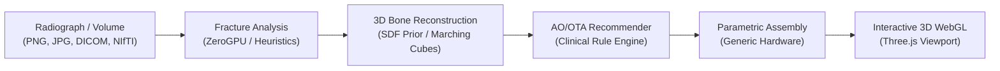

# 🦴 FemurFix Studio

> **Educational 3D Femur Fracture Fixation Simulator & Radiograph Pipeline**

[](https://www.python.org/downloads/)
[](https://fastapi.tiangolo.com)
[](https://react.dev)
[](https://threejs.org)
[](https://vitejs.dev)
[](https://tailwindcss.com)
[](https://opensource.org/licenses/MIT)

FemurFix Studio is a full-stack, simulation-first medical educational application. It processes 2D femoral radiographs (X-rays) or 3D volumetric scans (CT/MRI), reconstructs an estimated 3D femur bone, detects and classifies fractures according to the **AO/OTA fracture classification system**, recommends evidence-informed generic fixation constructs, and renders interactive 3D WebGL assemblies of the fractured bone and fixation hardware.

---

> [!CAUTION]
> ### ⚠️ Mandatory Medical Disclaimer
> **EDUCATIONAL SIMULATION ONLY.** This software is developed solely for educational, research, and technical demonstration purposes. It does **NOT** provide medical advice, diagnosis, treatment, surgical planning, or implant sizing. A single 2D radiograph cannot recover true 3D patient geometry; 3D models generated from X-rays are **estimated anatomical priors** and all uncalibrated measurements are estimates. This application is **not a certified medical device (SaMD)**. Clinical decisions must always be made by a qualified orthopaedic surgeon.

---

## 📸 Workflow & Core Pipeline



1. **Imaging Ingestion**: Accepts standard radiographs (`.png`, `.jpg`, `.jpeg`, `.dcm`), single/multi-frame DICOM series, and 3D volumetric files (`.nii`, `.nii.gz`, `.zip` DICOM stacks).
2. **Fracture Detection & Classification**: Isolates the femoral silhouette, detects cortical discontinuity, calculates fracture level ratio, and maps to the AO/OTA fracture scheme (Proximal `31`, Shaft `32`, Distal `33`). Integrates with Hugging Face ZeroGPU Spaces with deterministic fallback heuristics.
3. **Parametric 3D Bone Reconstruction**:
   - **X-Ray Path**: Smooth Signed Distance Field (SDF) anatomical prior blending head, neck, trochanters, shaft, and condyles, meshed via Marching Cubes and scaled to patient silhouette measurements.
   - **CT/MRI Path**: Voxel thresholding (`>200 HU` bone, `<1500 HU` metal filtering) with Marching Cubes, Laplacian smoothing, and quadric decimation.
   - Slices bone into proximal and distal fragments at the fracture plane.
4. **Fixation Recommender**: Scores and ranks generic fixation constructs with explainable rationale and caveats, providing dual language registers for **Surgeons** and **Patients**.
5. **Parametric 3D Assembly**: Places procedural fixation hardware (plates, lag screws, intramedullary rods, locking bolts) and exports multi-node binary GLB files with PBR materials for interactive WebGL rendering.

---

## 🛠️ Supported Generic Fixation Constructs

All implants are modeled procedurally in-house without proprietary vendor CAD:

| Device | Anatomical Region | Typical AO/OTA Indication | Construct Description |
|---|---|---|---|
| **Cannulated Screws (3)** | Proximal (Neck) | `31-B` (Transcervical / Subcapital) | Inverted triangle screw triad preserving femoral head vascularity |
| **Dynamic Hip Screw (DHS)** | Proximal (Trochanteric) | `31-A1`, `31-A2` (Intertrochanteric) | Sliding lag screw with lateral side plate allowing controlled collapse |
| **Cephalomedullary Nail** | Proximal (Subtrochanteric) | `31-A2`, `31-A3`, `31-C` | Intramedullary rod with femoral head lag screw and distal locking bolts |
| **Proximal Locking Plate** | Proximal | `31-A3`, `31-C` (Comminuted) | Contoured anatomical plate with multi-planar locking screw cluster |
| **Intramedullary (IM) Nail** | Diaphyseal Shaft | `32-A`, `32-B` (Simple / Wedge) | Load-sharing intramedullary rod with proximal and distal locking screws |
| **Shaft Locking Plate** | Diaphyseal Shaft | `32-C` (Comminuted shaft) | Lateral bridge plate spanning comminuted zones |
| **Distal Femoral Locking Plate** | Distal Femur | `33-A`, `33-B`, `33-C` (Supracondylar) | Contoured lateral plate with condylar and distal shaft locking fixation |

---

## 📂 Repository Layout

```
femurfix-studio/
├── backend/
│   ├── app/
│   │   ├── main.py                  # FastAPI application & REST endpoints
│   │   ├── services/
│   │   │   ├── image_loader.py      # X-ray & CT/MRI ingestion (DICOM / SimpleITK)
│   │   │   ├── xray_analyzer.py     # Fracture detection (ZeroGPU + Fallback)
│   │   │   ├── bone_reconstructor.py# SDF prior & Marching Cubes reconstructor
│   │   │   ├── implant_catalog.py   # Procedural 3D fixation implant geometry
│   │   │   ├── recommender.py       # AO/OTA rule engine & rationale builder
│   │   │   ├── assembly.py          # Fragment & hardware spatial assembler
│   │   │   ├── gltf_exporter.py     # PBR materials & GLB scene generation
│   │   │   └── mesh_processor.py    # Smoothing, decimation & surface repair
│   │   └── utils/
│   │       └── config.py            # Anatomical presets, thresholds, safety disclaimers
│   ├── tests/
│   │   ├── make_synthetic_xray.py   # Synthetic femur radiograph generator
│   │   └── e2e_check.py             # End-to-end pipeline verification script
│   └── requirements.txt             # Python dependencies
├── frontend/
│   ├── src/
│   │   ├── components/
│   │   │   ├── DisclaimerGate.jsx   # Mandatory educational consent screen
│   │   │   ├── UploadStep.jsx       # Radiograph & scan upload interface
│   │   │   └── SimView.jsx          # Interactive Three.js 3D viewer & simulator
│   │   ├── App.jsx                  # Main application flow coordinator
│   │   ├── main.jsx                 # React root DOM entry
│   │   └── index.css                # Tailwind styling
│   ├── index.html
│   ├── vite.config.js               # Dev server & API reverse proxy configuration
│   └── package.json
├── ml/
│   └── space/                       # Standalone Hugging Face ZeroGPU Space
│       ├── app.py                   # Gradio interface (/analyze_xray, /segment_femur)
│       └── requirements.txt
├── samples/                         # Sample femur radiographs for immediate testing
├── SPEC.md                          # Comprehensive technical and medical specification
└── README.md                        # Documentation
```

---

## 🚀 Quick Start Guide

### Prerequisites

- **Python**: `3.10+` (tested on Python 3.11)
- **Node.js**: `18.0+` & `npm`
- **Git**

---

### 1. Backend Setup

```bash
# Navigate to backend directory
cd backend

# Install Python dependencies
pip install -r requirements.txt

# Start FastAPI backend server (listens on 127.0.0.1:8000)
python -m uvicorn app.main:app --host 127.0.0.1 --port 8000 --reload
```

Verify backend health at: [http://127.0.0.1:8000/health](http://127.0.0.1:8000/health)

---

### 2. Frontend Setup

In a new terminal:

```bash
# Navigate to frontend directory
cd frontend

# Install Node dependencies
npm install

# Start Vite development server
npm run dev
```

Open your browser at: **[http://localhost:5173](http://localhost:5173)**

---

### 3. Testing with Sample Radiographs

Sample femur radiographs are included in the [`samples/`](samples/) folder for immediate evaluation:

1. Open `http://localhost:5173` in your browser.
2. Accept the educational disclaimer gate.
3. Upload any sample image from `samples/` (e.g. `samples/6d91c93a6a565320a67ff78ad8b240_big_gallery.jpg` or `samples/1.jpg`).
4. Click **Upload & Analyze**.
5. Explore the interactive 3D bone, review the AO/OTA fracture classification, switch between **Surgeon** and **Patient** perspectives, select a fixation implant, and generate the 3D assembly.

---

### 4. Running Backend Verification Tests

You can run automated end-to-end tests without starting the web servers:

```bash
cd backend
python tests/e2e_check.py
python tests/onnx_detector_check.py --model models/femur_fracture.onnx
python tests/eval_onnx_test_split.py --split test
```

To generate a new synthetic radiograph with customizable fracture patterns:

```bash
python tests/make_synthetic_xray.py --out test_femur.png
```

---

## 🧠 Fracture Model

The backend prefers a local YOLO11n fracture detector at `backend/models/femur_fracture.onnx`
(`onnxruntime`, CPU). It was trained on FracAtlas for 50 epochs on a Kaggle T4; held-out test
metrics are P 0.77 / R 0.29 / mAP50 0.34 at `conf=0.25`. The app uses `conf=0.15` for higher
recall. This is a research prototype, not a clinically validated detector; see
[`ml/README.md`](ml/README.md) for metrics, caveats, and the region-label roadmap.

Configuration: `LOCAL_ONNX_CONF`, `LOCAL_ONNX_IOU`, `FRACTURE_ONNX_MODEL`, `USE_LOCAL_ONNX=0`.
If the model file is absent or `USE_LOCAL_ONNX=0`, the analyzer falls back to the HF Space (if
configured) and then the built-in heuristic. The v1 ONNX binary is tracked in git; a fresh checkout
needs no manual download. Replace it only when integrating a retrained model. Current work status
and handoff notes are in [`PROGRESS.md`](PROGRESS.md).

---

## 🌐 Hugging Face ZeroGPU ML Space (Optional)

FemurFix Studio includes an optional Hugging Face ZeroGPU Space located in [`ml/space/`](ml/space/).
The local ONNX detector takes priority when installed; set `USE_LOCAL_ONNX=0` to force the Space.

1. Create a new Space on [Hugging Face Spaces](https://huggingface.co/spaces) with **SDK: Gradio** and hardware **ZeroGPU (A10G/H100)**.
2. Push the contents of `ml/space/` to your Space repository.
3. Configure your backend environment:
   ```bash
   export HF_SPACE_ID="your-username/femurfix-space"
   export HF_TOKEN="your_hf_token"
   ```
4. If `HF_SPACE_ID` is not configured or offline, the backend falls back to its deterministic
   image-processing heuristic analyzer.

---

## 🔒 Privacy & Data Handling

- **Zero PHI Retention**: Uploaded patient files are stored in temporary session directories and can be cleared via `DELETE /api/cases/{case_id}`.
- **Client Anonymization**: The API returns estimated meshes, metrics, and bounding boxes; it never leaks or serves raw DICOM metadata containing patient identifiers.

---

## 📄 License

This project is open-source under the [MIT License](LICENSE).
